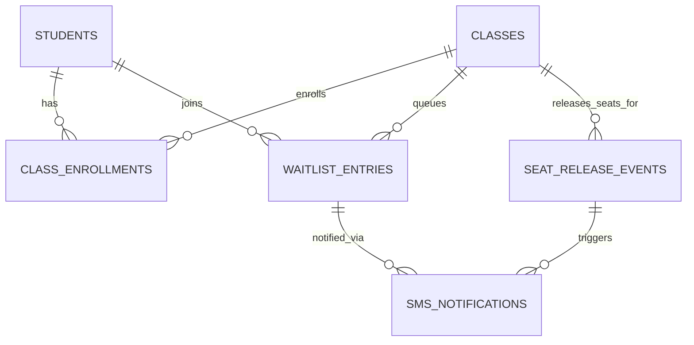
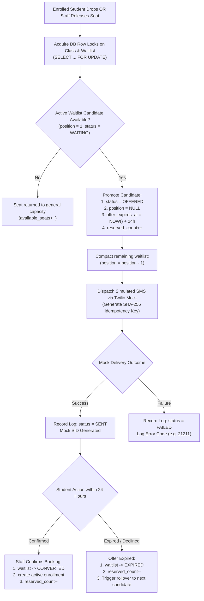

# Class Waitlist SMS Notification System (Twilio Mock)
### Enterprise Architecture Specification (Capstone 1)
**Ticket ID:** ENG-135180 | **Epic:** Core Infrastructure Overhaul | **Priority:** P1 - High | **Story Points:** 5

---

## 1. Executive Summary & Problem Statement

Educational institutions and training centers frequently face oversubscribed classes where physical or instructional capacity is constrained. Historically, academic administrative staff managed waitlists using paper sign-up sheets and manual Excel spreadsheets. 

### Operational Challenges:
- **Seat Under-Utilization:** Significant latency between a student dropping a class and staff manually identifying and contacting the next candidate, leading to vacant seats on term start.
- **Queue Discrepancies & Inequity:** Lost paper records and manual spreadsheet edits result in lost waitlist positions, sequence disputes, and unfair seat allocation.
- **High Administrative Burden:** Staff spend hundreds of hours manually coordinating student outreach via telephone calls and individual text messages.
- **Concurrency & Double-Booking:** Multiple staff members managing the same course spreadsheet concurrently often allocate the same opened seat to multiple students.

### The Solution:
The **Class Waitlist SMS Notification System** provides a centralized, ACID-compliant digital platform that automates real-time capacity monitoring, enforces strict First-In, First-Out (FIFO) queue priority, offers opened seats via a decoupled **Twilio Mock SMS Service**, and guarantees a safe two-phase booking confirmation process.

---

## 2. Core Features & Capabilities

- **Real-Time Capacity & Availability Tracking:** Automatic calculation of $\text{available\_seats} = \text{max\_capacity} - (\text{enrolled\_count} + \text{reserved\_count})$.
- **Deterministic FIFO Waitlist Ordering:** Guaranteed sequential ranks `[1..N]` for waiting students with automatic, atomic queue compaction on vacancies.
- **Two-Phase Seat Reservation Safety:** Sending a notification places the seat into an exclusive 24-hour reservation hold (`OFFERED`); enrollment is finalized (`CONVERTED`) only upon explicit confirmation, preventing accidental overbooking.
- **Pluggable Twilio Mock Service:** Zero-cost, credential-free SMS delivery simulation supporting deterministic test phone routing (`+15005550006` for success, `+15005550001` for invalid phone, `+15005550003` for timeout).
- **Idempotency & Concurrency Controls:** Cryptographic SHA-256 tokens and MySQL 8 row-level locking (`SELECT ... FOR UPDATE`) prevent double notifications and concurrent allocation races.
- **Accessible Monochromatic Dashboard:** High-contrast corporate UI designed to achieve WCAG 2.1 Level AA and Lighthouse Accessibility Score: 100.
- **Auditing & Telemetry:** Enterprise action logging and telemetry tracking (`[Analytics] User interacted with Class Waitlist SMS Notification Job (Twilio Mock)`) with complete PII masking.

---

## 3. Technology Stack

| Layer | Proposed Technology | Architectural Justification |
| :--- | :--- | :--- |
| **Database** | MySQL 8.0+ (InnoDB Engine) | Strict ACID compliance, row-level locking for concurrency, stored generated columns for conditional uniqueness, and check constraints. |
| **Backend API** | Node.js (v24 LTS) / REST | High-performance asynchronous I/O, modular service-oriented architecture, native TypeScript support. |
| **API Contract** | OpenAPI 3.0.3 (YAML) | Industry standard REST contract enabling type-safe client generation and mock validation. |
| **SMS Integration** | Twilio Mock Provider | Zero external network calls, zero carrier costs, deterministic failure simulation, drop-in replacement interface for future live Twilio SDK. |
| **Frontend (Future)**| React (TypeScript) | Component-driven UI, WCAG 2.1 AA accessible monochromatic design system, 16px/32px spacing grids. |
| **Testing Strategy** | Vitest, Supertest, Testcontainers, Playwright | Fast unit tests, genuine containerized MySQL 8 integration, HTTP contract testing, and Axe-core accessibility auditing. |

---

## 4. System Architecture & Relational Topology

### 4.1 Relational Data Model (7 Core Entities)
1. **`students`**: Master student directory enforcing E.164 phone validation (`^\+[1-9]\d{1,14}$`).
2. **`classes`**: Course catalog sections defining seating limits, schedules, and offer expiration timeouts.
3. **`class_enrollments`**: Official registrations; stored virtual token guarantees **at most one active enrollment per student per class**.
4. **`seat_release_events`**: Immutable audit ledger recording every formal seat vacancy event (drops, capacity expansions, timeouts).
5. **`waitlist_entries`**: FIFO queues with contiguous integer ranks `[1..N]`; stored virtual token guarantees **at most one active waitlist entry per student per class**.
6. **`sms_notifications`**: Complete dispatch audit trail for simulated Twilio SMS notifications, enforcing idempotency and sequencing retries (capped at 3).
7. **`system_audit_logs`**: General security, administrative action, and telemetry log scrubbed of sensitive PII.



---

## 5. End-to-End System Workflow



---

## 6. Project Documentation Index

All technical specifications, contracts, and design documents are versioned within the repository:

| Document | Description |
| :--- | :--- |
| [`database/schema.sql`](file:///c:/Users/amles/Desktop/tw/database/schema.sql) | Complete MySQL 8 production DDL, indexes, seed data, and transactional query recipes. |
| [`docs/REQUIREMENTS.md`](file:///c:/Users/amles/Desktop/tw/docs/REQUIREMENTS.md) | Comprehensive functional (FR-01..22) and non-functional requirements (NFR-01..13). |
| [`docs/DATABASE_SCHEMA.md`](file:///c:/Users/amles/Desktop/tw/docs/DATABASE_SCHEMA.md) | Exhaustive Data Dictionary, constraint specifications, and index execution plan analysis. |
| [`docs/ERD.md`](file:///c:/Users/amles/Desktop/tw/docs/ERD.md) | Visual Mermaid Entity-Relationship Diagram and cardinality breakdown. |
| [`docs/API_CONTRACTS.md`](file:///c:/Users/amles/Desktop/tw/docs/API_CONTRACTS.md) | 14 REST endpoint contracts, query parameters, validation rules, and JSON payloads. |
| [`docs/openapi.yaml`](file:///c:/Users/amles/Desktop/tw/docs/openapi.yaml) | Validated OpenAPI 3.0.3 specification with reusable schemas and error models. |
| [`docs/BUSINESS_RULES.md`](file:///c:/Users/amles/Desktop/tw/docs/BUSINESS_RULES.md) | Domain business logic, waitlist state machines, capacity formulas, and queue compaction. |
| [`docs/EDGE_CASES.md`](file:///c:/Users/amles/Desktop/tw/docs/EDGE_CASES.md) | 18 failure scenarios, race conditions, network disconnections, and recovery strategies. |
| [`docs/TWILIO_MOCK_DESIGN.md`](file:///c:/Users/amles/Desktop/tw/docs/TWILIO_MOCK_DESIGN.md) | Zero-cost SMS simulation architecture, test phone routing patterns, and migration blueprint. |
| [`docs/SECURITY.md`](file:///c:/Users/amles/Desktop/tw/docs/SECURITY.md) | OWASP Top 10 defenses, parameterized SQL queries, context-aware escaping, and PII masking. |
| [`docs/ACCESSIBILITY.md`](file:///c:/Users/amles/Desktop/tw/docs/ACCESSIBILITY.md) | WCAG 2.1 AA / Lighthouse 100 targets, monochromatic design system, and ARIA markup. |
| [`docs/SYSTEM_ARCHITECTURE.md`](file:///c:/Users/amles/Desktop/tw/docs/SYSTEM_ARCHITECTURE.md) | Modular SOA design, transaction boundaries, row locking, and React dashboard layout. |
| [`docs/TEST_PLAN.md`](file:///c:/Users/amles/Desktop/tw/docs/TEST_PLAN.md) | 32 TDD test specifications covering Unit, Integration, API, Security, and Accessibility. |
| [`docs/CAPSTONE_1_COMPLETION_REPORT.md`](file:///c:/Users/amles/Desktop/tw/docs/CAPSTONE_1_COMPLETION_REPORT.md) | Formal Capstone 1 sign-off report, audit checklists, and next-phase recommendations. |
| [`PROMPTS.md`](file:///c:/Users/amles/Desktop/tw/PROMPTS.md) | Mandatory prompt traceability log documenting all user prompts and generated outputs. |

---

## 7. Setup & Execution Guidelines (Future Implementation Phase)

> [!NOTE]
> The current assignment is strictly scoped to **Capstone 1: Architecture & Database Schema Design**. No production feature code or live database connections are initiated during this phase.

### Prerequisites for Future Capstone 2:
- Node.js v24.x LTS
- Docker Desktop (for containerized MySQL 8 testing via Testcontainers)
- MySQL 8.0+ CLI (optional local client)

### Proposed Development Workflow:
```bash
# 1. Initialize dependencies
npm install

# 2. Run TDD Test Suite (Failing until implementation begins)
npm run test

# 3. Seed Local MySQL 8 Database
npm run db:migrate
npm run db:seed

# 4. Start Development Server
npm run dev
```

---

## 8. Project Roadmap

- [x] **Capstone 1 (Current Phase):** Architecture, Database Schema, ERD, API Contracts, Business Logic, Security, Accessibility, and TDD Specifications.
- [ ] **Capstone 2 (Backend Implementation):** TDD execution of domain services, MySQL repository implementation, Twilio Mock service, and REST controllers.
- [ ] **Capstone 3 (Frontend & Integration):** Monochromatic React staff dashboard, WCAG 2.1 AA keyboard accessibility, and Lighthouse 100 audit.
- [ ] **Capstone 4 (Production Hardening):** Containerization, live Twilio provider adapter, rate limiting, and end-to-end load testing.

---
*Maintained by the Core Architecture Team. Ticket ENG-135180.*
