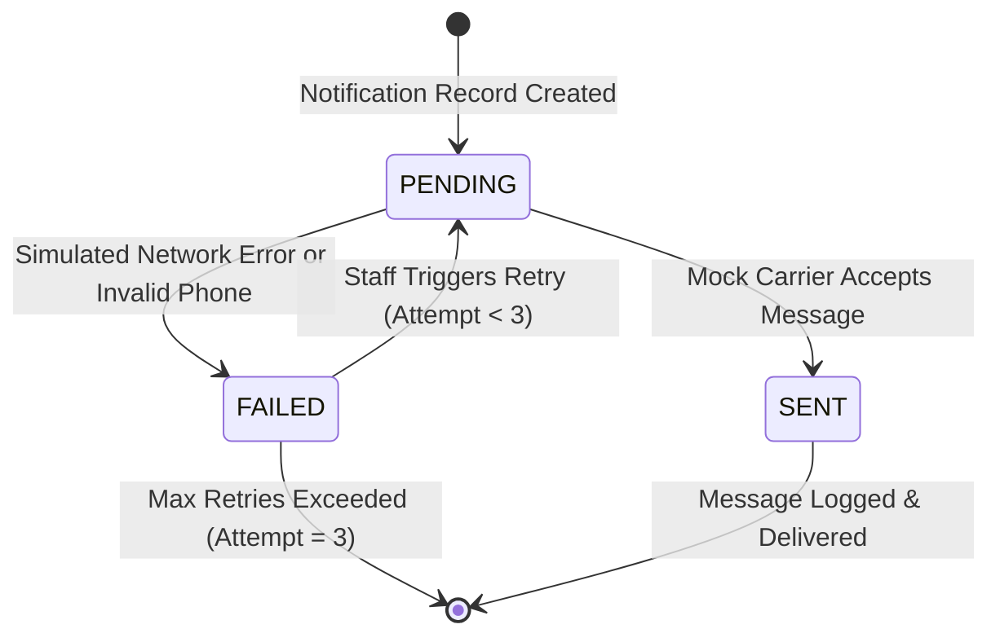

# Business Logic & Rules Specification
## Class Waitlist SMS Notification Job (Twilio Mock)
**Ticket ID:** ENG-135180  
**Epic:** Core Infrastructure Overhaul  
**Status:** Approved Architecture Baseline (Capstone 1)  
**Associated Contracts:** [`docs/API_CONTRACTS.md`](file:///c:/Users/amles/Desktop/tw/docs/API_CONTRACTS.md) | [`database/schema.sql`](file:///c:/Users/amles/Desktop/tw/database/schema.sql)  

---

## 1. Domain Entities & State Machines

### 1.1 Complete Waitlist Lifecycle State Machine

A waitlist entry progresses through deterministic state transitions governing its queue position, seat reservation validity, and audit history.

```mermaid
stateDiagram-v2
    [*] --> WAITING : Student Enters Waitlist (Class Full)
    
    WAITING --> OFFERED : Seat Vacancy Detected & Offer Dispatched
    WAITING --> WITHDRAWN : Student Voluntarily Withdraws
    WAITING --> CANCELLED : Course Cancelled by Administration

    OFFERED --> CONVERTED : Student Confirms Offer (Two-Phase Booking)
    OFFERED --> EXPIRED : 24-Hour Offer Window Elapses
    OFFERED --> WITHDRAWN : Student Rejects / Withdraws During Offer

    CONVERTED --> [*] : Active Class Enrollment Created
    EXPIRED --> [*] : Seat Recycled; Next Candidate Promoted
    WITHDRAWN --> [*] : Position Vacated; Queue Compacted
    CANCELLED --> [*] : All Pending Entries Finalized
```



#### Detailed State Transition Definitions:
| State | Position Value | Description & Constraints | Permitted Next States |
| :--- | :--- | :--- | :--- |
| **`WAITING`** | Positive Integer `[1..N]` | The student is in the active FIFO queue awaiting an opening. Position is unique within the class. | `OFFERED`, `WITHDRAWN`, `CANCELLED` |
| **`OFFERED`** | `NULL` | A seat has opened and has been reserved exclusively for this student for 24 hours. The student vacates their numeric queue rank. | `CONVERTED`, `EXPIRED`, `WITHDRAWN` |
| **`CONVERTED`** | `NULL` | The student accepted the offer within the window. Staff finalized the booking; an active row in `class_enrollments` is created. Terminal state. | None |
| **`EXPIRED`** | `NULL` | The 24-hour reservation window elapsed without confirmation. The reserved seat is released back to the class or the next candidate. Terminal state. | None |
| **`WITHDRAWN`** | `NULL` | The student voluntarily opted out of the waitlist or declined the offer. Terminal state. | None |
| **`CANCELLED`** | `NULL` | The academic course was cancelled or administrative override removed the entry. Terminal state. | None |

---

## 2. Capacity & Invariant Rules

### 2.1 Real-Time Capacity Calculation
The capacity state of any course is governed by the invariant formula:
$$\text{available\_seats} = \text{max\_capacity} - (\text{enrolled\_count} + \text{reserved\_count})$$
Where:
- $\text{max\_capacity}$: Physical room seating limit (`classes.max_capacity > 0`).
- $\text{enrolled\_count}$: Count of active enrollments where `class_enrollments.status = 'ENROLLED'`.
- $\text{reserved\_count}$: Count of active seat reservations where `waitlist_entries.status = 'OFFERED'` AND `offer_expires_at > CURRENT_TIMESTAMP`.

### 2.2 Capacity Enforcement Invariants
1. **Direct Enrollment Invariant:** A student can only directly enroll (`POST /api/classes/{id}/enroll`) if and only if $\text{available\_seats} \ge 1$.
2. **Waitlist Placement Invariant:** A student can only join the waitlist (`POST /api/classes/{id}/waitlist`) if and only if $\text{available\_seats} \le 0$. If $\text{available\_seats} > 0$, the request is rejected with `400 Bad Request` (`CLASS_HAS_AVAILABLE_SEATS`).
3. **Hard Ceiling Invariant:** The sum of $(\text{enrolled\_count} + \text{reserved\_count})$ must never exceed $\text{max\_capacity}$.

---

## 3. FIFO Waitlist Processing & Queue Contiguity

### 3.1 Strict Ordinal Contiguity
- Waitlist positions for `WAITING` entries must form a strictly contiguous sequence:
  $$\text{positions} \in \{1, 2, 3, \dots, N\}$$
- When an entry is first inserted, it receives:
  $$\text{new\_position} = \text{COALESCE}(\max(\text{position}), 0) + 1$$
- No two students can hold the same position in a class simultaneously, enforced by database constraint:
  `UNIQUE KEY uq_class_position (class_id, position)`.

### 3.2 Dynamic Queue Compaction (Shift Up)
Whenever an entry in position $K$ transitions out of `WAITING` (promoted to `OFFERED`, `WITHDRAWN`, or `CANCELLED`), an atomic positional shift occurs within the same database transaction:
```sql
UPDATE waitlist_entries
SET position = position - 1
WHERE class_id = :classId 
  AND status = 'WAITING' 
  AND position > :vacatedPosition;
```
This guarantees that if position 2 is removed, position 3 immediately becomes position 2, and position 4 becomes position 3, eliminating all gaps.

---

## 4. Two-Phase Seat Reservation & Confirmation Workflow

### 4.1 Safety Model: Why Notifications Do Not Auto-Enroll
In legacy systems, sending an automated notification often prematurely confirmed a student, creating chaotic overbooking when students had moved on, lost interest, or failed to see the message.

The architecture enforces a **Two-Phase Commit Pattern**:
1. **Phase 1: Reserve & Offer (`OFFERED`)**
   - The seat is locked exclusively for the candidate (`reserved_count++`).
   - An offer window is initiated: `offer_expires_at = CURRENT_TIMESTAMP + INTERVAL 24 HOUR`.
   - A simulated SMS notification is dispatched via Twilio Mock.
   - The student remains un-enrolled until explicit confirmation.
2. **Phase 2: Formal Booking Confirmation (`CONVERTED`)**
   - Upon receiving verbal or digital confirmation, staff triggers `POST /api/waitlist/{waitlistId}/confirm`.
   - The entry transitions to `CONVERTED`.
   - An active enrollment is inserted into `class_enrollments`.
   - `reserved_count` decreases by 1; `enrolled_count` increases by 1.

### 4.2 Offer Expiration & Rollover
- If `offer_expires_at` is reached without confirmation:
  1. The entry status updates to `EXPIRED`.
  2. The held seat is released back to the class pool.
  3. The next candidate at `position = 1` is automatically selected and promoted to `OFFERED`.

---

## 5. Notification Status Transitions & Retry Policies

### 5.1 SMS Notification State Machine


### 5.2 Retry Rules & Thresholds
1. **Maximum Retry Limit:** A maximum of **3 attempts** is permitted per waitlist offer (`attempt_number <= 3`).
2. **Retry Eligibility:** Only notifications with `status = 'FAILED'` can be retried. Attempting to retry a `SENT` notification returns `400 Bad Request` (`NOTIFICATION_ALREADY_SENT`).
3. **Attempt Tracking:** Each retry creates a new notification record or updates the attempt counter while preserving previous diagnostic error codes (`21211`, `30008`, `54000`).
4. **Circuit Breaker:** If `attempt_number >= 3` and the dispatch fails, the system marks the entry for manual administrative intervention (`MAX_RETRIES_EXCEEDED`) and halts automated retries.

---
*End of Document. Business Rules Specification.*
