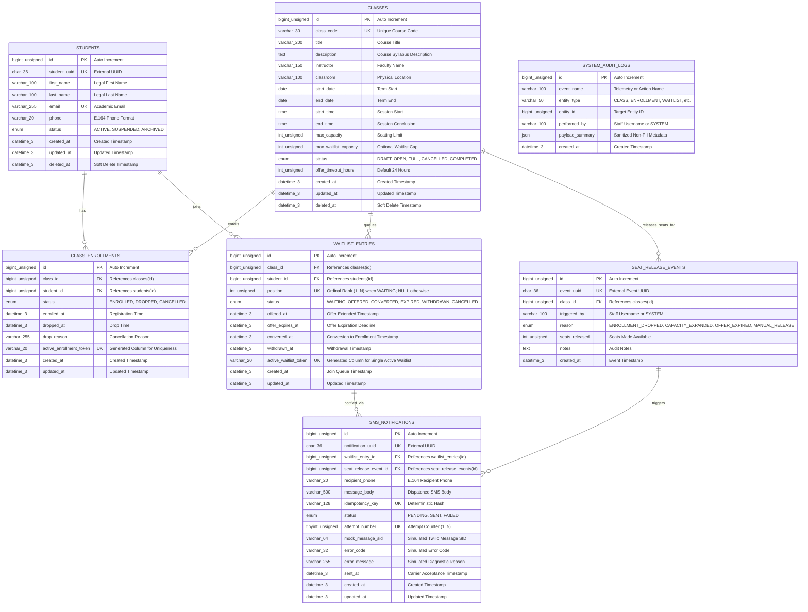

# Entity Relationship Diagram (ERD)
## Class Waitlist SMS Notification Job (Twilio Mock)
**Ticket ID:** ENG-135180  
**Epic:** Core Infrastructure Overhaul  
**Database Engine:** MySQL 8.0+ (InnoDB)  
**Document File:** `docs/ERD.md`  

---

## 1. Visual Entity Relationship Diagram (Mermaid)

The following Mermaid ER diagram illustrates the complete relational topology, table attributes, primary keys (`PK`), foreign keys (`FK`), unique keys (`UK`), and relationship cardinalities across all entities.



---

## 2. Cardinality & Relationship Breakdown

### 2.1 Students to Class Enrollments (`STUDENTS` 1 : N `CLASS_ENROLLMENTS`)
- **Cardinality:** One-to-Many (`1 : 0..*`).
- **Description:** A student may have zero or many class enrollments over time.
- **Integrity Rule:** A student can only have **at most one** active enrollment (`status = 'ENROLLED'`) for any single class, enforced by compound unique index `(class_id, student_id, active_enrollment_token)`.

### 2.2 Classes to Class Enrollments (`CLASSES` 1 : N `CLASS_ENROLLMENTS`)
- **Cardinality:** One-to-Many (`1 : 0..*`).
- **Description:** A class has zero or many student enrollments.
- **Integrity Rule:** The total count of active enrollments plus active reservation offers cannot exceed `max_capacity`.

### 2.3 Students to Waitlist Entries (`STUDENTS` 1 : N `WAITLIST_ENTRIES`)
- **Cardinality:** One-to-Many (`1 : 0..*`).
- **Description:** A student can join waitlists for multiple distinct classes.
- **Integrity Rule:** A student can only have **one** active waitlist record (`status IN ('WAITING', 'OFFERED')`) per class, enforced by compound unique index `(class_id, student_id, active_waitlist_token)`.

### 2.4 Classes to Waitlist Entries (`CLASSES` 1 : N `WAITLIST_ENTRIES`)
- **Cardinality:** One-to-Many (`1 : 0..*`).
- **Description:** A class has zero or many waitlist entries.
- **Integrity Rule:** For entries in `WAITING` status, `position` must be uniquely ordered `(class_id, position)` with no duplicate ranks.

### 2.5 Classes to Seat Release Events (`CLASSES` 1 : N `SEAT_RELEASE_EVENTS`)
- **Cardinality:** One-to-Many (`1 : 0..*`).
- **Description:** Every time a student drops, capacity expands, or an offer times out, an immutable event record is created referencing the parent class.

### 2.6 Seat Release Events to SMS Notifications (`SEAT_RELEASE_EVENTS` 1 : N `SMS_NOTIFICATIONS`)
- **Cardinality:** One-to-Many (`1 : 0..*`).
- **Description:** A single seat release event can trigger one or multiple notification dispatches (e.g., if multiple seats were released simultaneously, or if retries occur). Nullable if notification is manually triggered.

### 2.7 Waitlist Entries to SMS Notifications (`WAITLIST_ENTRIES` 1 : N `SMS_NOTIFICATIONS`)
- **Cardinality:** One-to-Many (`1 : 1..*`).
- **Description:** A waitlist entry receives one initial notification attempt when an offer is extended, and may receive subsequent retry records if the mock simulates a failure.
- **Integrity Rule:** Each attempt increments `attempt_number`. The compound constraint `UNIQUE (waitlist_entry_id, attempt_number)` guarantees strict audit sequencing.

---

## 3. GitHub & Renderer Verification

This Mermaid file is formatted using standard GFM (GitHub Flavored Markdown) Mermaid block syntax (````mermaid ... ````) and is verified to render natively on GitHub, GitLab, and Markdown previewers supporting Mermaid v10+.

---
*End of Document. Prepared for Architecture Approval prior to Phase 4 (API Contracts).*
