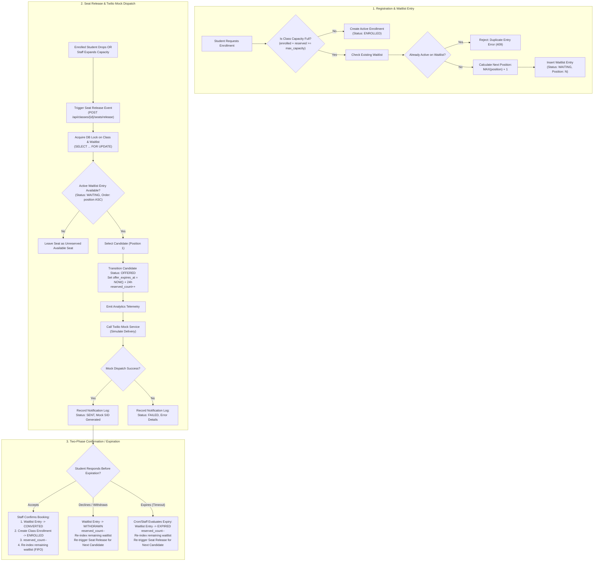

# Technical Requirements Document (TRD)
## Class Waitlist SMS Notification Job (Twilio Mock)
**Ticket:** ENG-135180  
**Epic:** Core Infrastructure Overhaul  
**Priority:** P1 - High | **Story Points:** 5  
**Version:** 1.0.0 (Architecture Baseline)  
**Status:** In Architecture Review (Capstone 1)  

---

## 1. Executive Summary & Business Context

Educational institutions, training facilities, and corporate learning centers frequently encounter oversubscribed courses where demand exceeds physical or pedagogical class capacity. Currently, administrative staff manage student demand using ad-hoc, paper-based forms and manually edited spreadsheets (Excel/Google Sheets).

### 1.1 The Operational Problem
- **Seat Under-Utilization:** When an enrolled student drops a class or administrative capacity is expanded, staff must manually inspect paper logs, identify the next student, and dial phone numbers. Lags in contact often leave seats vacant when classes commence.
- **Queue Inequity & Human Error:** Manual records suffer from lost forms, accidental re-ordering of waitlisted students, and dispute resolution failures regarding who held priority.
- **Operational Overhead:** Staff spend excessive hours manually managing notifications and reconciliations instead of advising students.
- **Concurrency & Race Conditions:** When multiple staff members simultaneously attempt to backfill vacant seats from the same spreadsheet, seats are double-booked or duplicate/contradictory communications are sent to students.

### 1.2 The Proposed Solution
The **Class Waitlist SMS Notification System** provides a centralized, transactional digital platform that:
1. Replaces manual records with an ACID-compliant relational data store (MySQL 8).
2. Maintains a strictly ordered, first-come, first-served (FIFO) queue for oversubscribed classes.
3. Automatically evaluates seat availability upon enrollment cancellation or capacity expansion.
4. Orchestrates automated, simulated SMS delivery via a dedicated **Twilio Mock Service**.
5. Implements a safe, two-phase seat reservation and confirmation workflow to prevent accidental overbooking.
6. Guarantees idempotency and strict duplicate notification prevention across concurrent worker processes.

---

## 2. Stakeholders & User Roles

| Role | Description | Core Responsibilities & Permissions |
| :--- | :--- | :--- |
| **Academic Staff (Staff)** | Front-line administrative personnel who manage daily classroom logistics and student registrations. | - View class catalog, schedules, and live capacities.<br>- Register eligible students into classes.<br>- Place students onto class waitlists.<br>- Manually release seats when cancellations occur.<br>- Trigger and monitor notification dispatches.<br>- Manually retry failed notifications.<br>- Confirm student acceptance of offered seats. |
| **Operations Manager (Manager)** | Department heads and senior administrators responsible for academic schedule policy, audit oversight, and system health. | - All Staff permissions.<br>- Create, update, reschedule, or cancel classes.<br>- Alter class capacity thresholds.<br>- Access complete audit logs, notification telemetry, and error reports.<br>- Force-evict or re-order waitlist positions under exceptional academic appeal circumstances. |
| **System / Automated Worker** | Background worker or scheduled cron service executing asynchronous tasks. | - Poll or listen for seat availability events.<br>- Dispatch queued notification jobs to the Twilio Mock Service.<br>- Execute retry backoff policies for transient mock failures.<br>- Expire unaccepted seat reservation offers past their deadline. |
| **Student (End-User / Recipient)** | Passive participant receiving communications via simulated SMS. | - Receives simulated SMS notifications regarding seat availability.<br>- In future phases: Interacts via SMS short-codes or web links to accept/decline seat offers. |

---

## 3. Functional Requirements (FR)

### 3.1 Class Management
- **FR-01 (Class Catalog):** The system shall allow authorized staff to create, view, update, and list academic classes with attributes including class code, title, description, instructor, schedule (start/end dates, times), classroom/location, maximum capacity, and operational status (`DRAFT`, `OPEN`, `FULL`, `CANCELLED`, `COMPLETED`).
- **FR-02 (Capacity Enforcement):** The system shall compute real-time enrolled counts against `max_capacity`. When active enrollments equal or exceed `max_capacity`, the class status shall automatically transition to or reflect `FULL`.
- **FR-03 (Seat Availability Querying):** The system shall provide an endpoint to return instantaneous capacity metrics: `max_capacity`, `enrolled_count`, `reserved_count` (seats held during an open offer window), `available_seats`, and `waitlisted_count`.

### 3.2 Student Profile Management
- **FR-04 (Student Registration):** The system shall store student demographic and contact records, including unique student ID, first name, last name, institutional email address, and E.164-compliant mobile phone number.
- **FR-05 (Contact Validation):** The system shall enforce phone number formatting according to the international E.164 standard (e.g., `+1XXXXXXXXXX`) prior to persisting student records.

### 3.3 Enrollment & Seat Release
- **FR-06 (Direct Enrollment):** The system shall allow staff to enroll an eligible student directly into an open class if `available_seats > 0`.
- **FR-07 (Seat Cancellation / Drop):** The system shall allow staff to cancel or drop an active student enrollment, updating the enrollment status to `DROPPED` or `CANCELLED`.
- **FR-08 (Explicit Seat Release Trigger):** The system shall support a dedicated administrative action (`POST /api/classes/{classId}/seats/release`) enabling staff to formally declare released seats available for waitlist allocation.

### 3.4 Waitlist Queue Management
- **FR-09 (Waitlist Enrollment):** When a class is at capacity (`available_seats == 0`), staff shall be able to place an eligible student onto the waitlist.
- **FR-10 (Strict FIFO Ordinal Ordering):** The system shall assign an explicit, positive integer position (`position = 1, 2, 3...`) to each waitlist entry based strictly on creation timestamp order.
- **FR-11 (Dynamic Queue Re-indexing):** When a student is removed, promoted, or withdraws from the waitlist, all subsequent active waitlist entries for that class shall dynamically shift their ordinal position upwards without gaps (e.g., position 3 becomes position 2).
- **FR-12 (Duplicate Waitlist Prevention):** A student shall not hold more than one active waitlist entry for the same class simultaneously.
- **FR-13 (Waitlist Withdrawal):** Staff or students shall be able to withdraw a waitlist entry at any time, transitioning its status to `WITHDRAWN` and triggering queue re-indexing.

### 3.5 Seat Reservation & Notification Workflow (Two-Phase Allocation)
- **FR-14 (Safe Reservation Window):** Sending a notification shall **not** automatically enroll the student. Instead, the system shall transition the waitlist entry to an `OFFERED` status, reserve one seat (`reserved_count++`), and generate a time-bound reservation window (e.g., 24 hours).
- **FR-15 (Offer Acceptance):** If the student accepts within the window, staff confirms the booking, transitioning the waitlist entry to `CONVERTED` and creating an active record in `class_enrollments`.
- **FR-16 (Offer Expiration & Roll-over):** If the offer expires without confirmation, the waitlist entry transitions to `EXPIRED`, the reserved seat is released back to the class, and the system automatically or manually triggers an offer to the next eligible student in line (`position = 1`).

### 3.6 Twilio Mock SMS Notification Engine
- **FR-17 (Simulated SMS Dispatch):** The system shall interface with an isolated Twilio Mock Service that mimics the external Twilio REST API without initiating live network calls or consuming carrier fees.
- **FR-18 (Notification Audit Logging):** Every dispatch attempt shall generate a persistent audit record capturing: `notification_id`, `waitlist_entry_id`, `recipient_phone`, `message_body`, `dispatch_status` (`PENDING`, `SENT`, `FAILED`), `attempt_number`, `mock_message_sid`, `error_code`, `error_message`, and `sent_at`.
- **FR-19 (Controlled Simulation Failure):** The mock service shall accept test flags or header directives (e.g., specific test phone numbers or environment toggles) to simulate downstream carrier errors (e.g., `21211: Invalid Phone Number`, `30008: Unknown Error`, network timeout).
- **FR-20 (Safe Idempotent Retry):** Staff shall be able to trigger a retry for any notification with `FAILED` status (`POST /api/notifications/{notificationId}/retry`). The system shall increment the `attempt_number`, maintain audit history, and prevent retry loops if the maximum attempt threshold (default: 3) is exceeded.

### 3.7 Observability & Telemetry
- **FR-21 (Enterprise Telemetry Event):** The system shall emit a structured telemetry log event:  
  `[Analytics] User interacted with Class Waitlist SMS Notification Job (Twilio Mock)`  
  whenever staff or automated background jobs trigger waitlist queries, seat releases, notification dispatches, or retries.
- **FR-22 (Privacy in Telemetry):** Telemetry logs shall contain event names, entity IDs, timestamps, and outcome statuses, but **must never** log student phone numbers, email addresses, or unmasked PII.

---

## 4. Non-Functional Requirements (NFR)

### 4.1 Data Integrity & Concurrency Control (ACID)
- **NFR-01 (Strict Relational Integrity):** All database entities must be managed under MySQL 8 InnoDB engine with strict foreign key constraints, cascade rules, and check constraints where supported.
- **NFR-02 (Pessimistic Row-Level Locking):** Critical seat-allocation operations (evaluating capacity, incrementing reservation counters, selecting `next_in_line` waitlist entries) must execute within database transactions utilizing `SELECT ... FOR UPDATE` row locks to completely eliminate race conditions and double-booking under concurrent load.
- **NFR-03 (Idempotency Enforcement):** Every notification dispatch operation must carry or derive an idempotency token (e.g., `hash(waitlist_entry_id + seat_allocation_event_id)`). Duplicate requests with an identical token must return the cached execution result rather than generating secondary notifications.

### 4.2 Performance & Responsiveness
- **NFR-04 (API Latency):** Core transactional endpoints (class lookups, waitlist additions, seat releases) must respond within **p95 < 150ms** under standard campus operational load.
- **NFR-05 (Optimized Indexing):** Composite indexes must be designed specifically for query predicates used in FIFO selection (e.g., `(class_id, status, position ASC)`) and notification audit lookups (e.g., `(waitlist_entry_id, created_at DESC)`).

### 4.3 Reliability & Fault Tolerance
- **NFR-06 (Graceful Mock Failure Handling):** Failures in the Twilio Mock layer must never roll back or corrupt the underlying database state. The transaction recording the reservation state must commit independently from the notification dispatch audit log.
- **NFR-07 (Connection Resilience):** The backend database connection pool must handle transient disconnection with reconnection retry backoffs and proper transaction aborts.

### 4.4 Security & Privacy
- **NFR-08 (Zero Secret Storage):** The system must not store or require actual Twilio Account SIDs or Auth Tokens during the mock phase.
- **NFR-09 (SQL Injection & XSS Prevention):** All database interaction must exclusively utilize parameterized queries / prepared statements. Output rendering must employ context-aware escaping.
- **NFR-10 (PII Protection & Data Minimization):** Student phone numbers and email addresses must only be visible to authorized Staff and Manager roles. API responses must avoid dumping unneeded PII fields.
- **NFR-11 (Role-Based Authorization):** Management endpoints (e.g., altering class capacity, retrying system notifications) must enforce role checks ensuring unauthenticated or unauthorized actors cannot manipulate waitlists.

### 4.5 Accessibility & Design Standards
- **NFR-12 (Accessibility Target):** The planned user interface must achieve a **Lighthouse Accessibility Score of 100** and comply with **WCAG 2.1 AA** standards.
- **NFR-13 (Design System):** Monochromatic, high-contrast enterprise design system utilizing consistent 16px/32px spacing grids, semantic HTML elements, visible `:focus-visible` rings, and full keyboard navigability.

---

## 5. End-to-End System Workflows



---

## 6. Business Rules & Logic Specifications

### BR-01: Class Capacity Calculation
- `available_seats = max_capacity - (enrolled_count + reserved_count)`
- Where:
  - `enrolled_count`: Count of records in `class_enrollments` with `status = 'ENROLLED'`.
  - `reserved_count`: Count of records in `waitlist_entries` with `status = 'OFFERED'` whose `offer_expires_at > CURRENT_TIMESTAMP`.
- Invariant: `(enrolled_count + reserved_count) <= max_capacity`. If `available_seats <= 0`, direct enrollment is strictly prohibited.

### BR-02: FIFO Queue Positioning & Contiguity
- The student who enters the waitlist first for a given class must receive `position = 1`. Each subsequent student receives `position = previous_highest + 1`.
- Waitlist positions must remain contiguous positive integers `[1, 2, ..., N]` for all active `WAITING` entries.
- When an entry transitions out of `WAITING` (due to becoming `OFFERED`, `WITHDRAWN`, or `CANCELLED`), an atomic positional shift occurs:
  $$\forall \text{ entry } e \text{ where } \text{old\_position}_e > \text{vacated\_position}: \quad \text{new\_position}_e = \text{old\_position}_e - 1$$

### BR-03: Two-Phase Reservation and Offer Window
- A student notified of an opening is granted an exclusive reservation holding one seat for exactly **24 hours** (`offer_expires_at = NOW() + INTERVAL 24 HOUR`).
- While in `OFFERED` status, the student does not hold a numeric queue position (`position = NULL`), preventing queue shifts from disrupting waiting peers.
- If the offer expires without confirmation:
  1. The entry status updates to `EXPIRED`.
  2. The held seat returns to the pool (`reserved_count` decreases).
  3. The system selects the new head of the queue (`position = 1`) and issues a new offer.

### BR-04: Idempotency & Duplicate Notification Prevention
- A student cannot receive more than one SMS notification for the exact same seat release event.
- Every seat release event generates a deterministic `allocation_token` (UUID v4 or cryptographic hash).
- The `sms_notifications` table enforces a unique compound constraint:  
  `UNIQUE KEY uq_notification_event (waitlist_entry_id, allocation_token, attempt_number)`
- Any redundant dispatch attempt presenting the same `allocation_token` and `attempt_number` is intercepted at the database layer and rejected.

### BR-05: Controlled Retry Policy
- A notification may only be retried if its current status is `FAILED`.
- The maximum number of retry attempts per waitlist offer is **3**.
- A retry increments `attempt_number` by 1 and records the timestamp of the new attempt.
- Retrying an already `SENT` notification is rejected with HTTP 400 Bad Request.

---

## 7. Twilio Mock Architecture & Delivery Behavior

The Twilio Mock Service is an internal service abstraction that decouples the application from external telecommunication carriers during testing and development.

### 7.1 Interface Contract
The mock adheres to the standard Twilio REST API request and response semantics:
```typescript
interface TwilioMockRequest {
  to: string;             // Recipient phone number (E.164 format)
  from: string;           // Sender phone number or alphanumeric sender ID
  body: string;           // SMS content text
  idempotencyKey: string; // Token ensuring single execution
}

interface TwilioMockResponse {
  sid: string;            // Mock identifier: "SM" + 32-char hex string
  status: 'queued' | 'sent' | 'delivered' | 'failed';
  errorCode: string | null;
  errorMessage: string | null;
  dateCreated: string;
  dateSent: string | null;
}
```

### 7.2 Deterministic Simulation Rules
To test error resilience without external networks, the mock evaluates recipient phone numbers against reserved test patterns:

| Recipient Pattern | Mock Behavior | Simulated Result | Error Code |
| :--- | :--- | :--- | :--- |
| `+15005550006` | Valid recipient | **SENT** / Delivered | `None` |
| `+15005550001` | Invalid phone number | **FAILED** | `21211` ("Invalid 'To' Phone Number") |
| `+15005550002` | Carrier unreachable | **FAILED** | `30003` ("Unreachable destination handset") |
| `+15005550003` | Twilio mock timeout | **FAILED** (Simulated 504) | `54000` ("Downstream Gateway Timeout") |
| `+15005550004` | Blacklisted / Opted out | **FAILED** | `21610` ("Recipient opted out of SMS") |
| Any standard number | Standard execution | **SENT** (Latency: 50-100ms) | `None` |

### 7.3 Decoupling for Future Live Replacement
The application business layer interacts solely with an abstract `NotificationService` interface:
```typescript
interface NotificationService {
  sendWaitlistOfferSMS(payload: WaitlistNotificationPayload): Promise<NotificationResult>;
}
```
In future phases, switching from mock to live Twilio simply requires binding `LiveTwilioNotificationService` via dependency injection without modifying class, waitlist, or enrollment domain logic.

---

## 8. Comprehensive Edge Case Matrix

| ID | Edge Case Scenario | System Action & Resolution Strategy | Expected HTTP / DB Outcome |
| :--- | :--- | :--- | :--- |
| **EC-01** | Empty class catalog query | Return empty list with `200 OK` and structured pagination metadata `[]`. Do not treat as an error. | `200 OK`, `{"data": [], "total": 0}` |
| **EC-02** | Empty waitlist query | Return empty list with `200 OK` for valid `classId`. If `classId` is invalid/non-existent, return `404 Not Found`. | `200 OK` or `404 Not Found` |
| **EC-03** | Invalid student phone number format | Reject before database insertion using regex validation `^\+[1-9]\d{1,14}$`. | `400 Bad Request`, `{"error": "INVALID_PHONE_FORMAT"}` |
| **EC-04** | Missing or whitespace-only student name | Reject at API payload validation layer. | `400 Bad Request`, `{"error": "STUDENT_NAME_REQUIRED"}` |
| **EC-05** | Student attempts duplicate waitlist entry | Database compound unique constraint rejects duplicate active entry `(student_id, class_id, status='WAITING')`. | `409 Conflict`, `{"error": "STUDENT_ALREADY_WAITLISTED"}` |
| **EC-06** | Student already enrolled attempts to join waitlist | Query checks existing active enrollment `(status='ENROLLED')`. If present, reject waitlist request. | `400 Bad Request`, `{"error": "STUDENT_ALREADY_ENROLLED"}` |
| **EC-07** | Waitlist addition when seats are still available | If `available_seats > 0`, system advises direct enrollment or rejects waitlist addition based on policy. | `400 Bad Request`, `{"error": "CLASS_HAS_AVAILABLE_SEATS"}` |
| **EC-08** | Seat release triggered when no waitlist exists | Seat is released to general class capacity (`available_seats` increments). No notifications generated. | `200 OK`, `{"notified": false, "availableSeats": N}` |
| **EC-09** | Multiple seats released simultaneously | Execute in a single transactional batch. If $K$ seats open, select the top $K$ students ordered by `position ASC`, reserving $K$ seats and issuing $K$ distinct notifications. | `200 OK`, `{"offersIssued": K}` |
| **EC-10** | Concurrent seat release by two staff members | Handled via pessimistic locking (`SELECT ... FOR UPDATE`). Staff A locks the record and claims the student; Staff B's transaction waits and observes the updated state, selecting the next student or aborting if no seats remain. | Transaction isolation prevents double-allocation. |
| **EC-11** | Duplicate notification request (Rapid double-click) | Client-generated or server-derived `idempotency_key` rejects the second request or returns the identical initial response. | Second call returns `200 OK` (cached) or `409 Conflict`. |
| **EC-12** | SMS simulation failure (Simulated Twilio error) | Offer is retained (`status = OFFERED`), but notification audit log records `status = FAILED` with error code. Staff is alerted to retry. | `207 Multi-Status` or `200 OK` with failure flag. |
| **EC-13** | Database connection loss during notification dispatch | Database transaction for reservation rolls back cleanly. No orphaned reservation state exists. Notification is not dispatched. | `500 Internal Server Error`, clean rollback. |
| **EC-14** | Retry attempted on already successful notification | Validate existing notification status. If `SENT`, reject retry request. | `400 Bad Request`, `{"error": "NOTIFICATION_ALREADY_SENT"}` |
| **EC-15** | Retry exceeds maximum allowable threshold (3) | Reject retry when `attempt_number >= 3`. Mark entry for manual staff intervention. | `422 Unprocessable Entity`, `{"error": "MAX_RETRIES_EXCEEDED"}` |
| **EC-16** | Student withdraws while an offer is active (`OFFERED`) | Transition status to `WITHDRAWN`, decrement `reserved_count`, increment `available_seats`, and immediately trigger seat release for the next waiting candidate (`position = 1`). | `200 OK`, next candidate notified. |
| **EC-17** | Class cancellation with active waitlist | Bulk update all active waitlist entries to `CANCELLED`, mark class as `CANCELLED`, and log cancellation event. | `200 OK`, all entries finalized. |
| **EC-18** | Non-existent class ID provided | Lookup fails to find primary key. Return descriptive 404. | `404 Not Found`, `{"error": "CLASS_NOT_FOUND"}` |
| **EC-19** | Non-existent student ID provided | Lookup fails foreign key validation. Return descriptive 404. | `404 Not Found`, `{"error": "STUDENT_NOT_FOUND"}` |
| **EC-20** | Offer window expires without response | Scheduled background sweep marks entry `EXPIRED`, decrements `reserved_count`, and triggers a new offer to the next student in line. | Automated state transition. |

---

## 9. Assumptions & Unresolved Questions

### 9.1 Technical & Architectural Assumptions
1. **Single-Node MySQL Transaction Isolation:** We assume standard MySQL 8 running under InnoDB with `REPEATABLE READ` or `READ COMMITTED` isolation levels, using explicit `SELECT ... FOR UPDATE` row locks to govern seat allocation.
2. **Offer Reservation Duration:** Assumed to be **24 hours** by default, configurable at the system or class level via an `offer_timeout_hours` setting.
3. **Soft Deletions:** Assumed that student withdrawals, dropped enrollments, and cancelled classes use soft-deletion state flags (`status` column and `deleted_at` timestamp) rather than physical SQL `DELETE` operations, preserving historical auditing.
4. **Staff-Mediated Booking:** Assumed that in this phase (Capstone 1), staff manually executes the confirmation API upon receiving student verbal/email acceptance. Direct student two-way SMS reply processing is slated for a future phase.
5. **Simulated Notification Delivery Time:** Assumed that mock notifications complete synchronously within 50–100ms for testing predictability.

### 9.2 Identified Ambiguities & Open Questions
1. **Unresolved Question 1 (Waitlist Limit Policy):** Does a class have a maximum waitlist capacity (e.g., capped at 20% of class size), or is it unbounded?  
   *Current Architecture Stance:* Waitlist is unbounded by default, but schema supports an optional `max_waitlist_capacity` column in `classes`.
2. **Unresolved Question 2 (Multi-Class Cross-Registration):** Can a student waitlist for two different classes scheduled at the identical time slot?  
   *Current Architecture Stance:* Waitlists are decoupled per class; time-conflict validation is deferred to the enrollment confirmation step.
3. **Unresolved Question 3 (Auto-Promotion vs. Offer Expiry):** Should the system automatically trigger the next notification immediately upon offer expiration, or should it wait for staff to click "Release Next Seat"?  
   *Current Architecture Stance:* The architecture supports both: a manual staff trigger endpoint and an automated background worker specification.

---

## 10. Traceability & Sign-Off Checklist

- [x] Functional requirements mapped to ticket ENG-135180
- [x] Non-functional requirements (ACID, performance, security, a11y) documented
- [x] User and administrative roles delineated
- [x] End-to-end workflows (with Mermaid diagram) detailed
- [x] Two-phase reservation and offer confirmation workflow defined
- [x] Twilio Mock behavior and error patterns specified
- [x] 20 distinct edge cases and race conditions detailed
- [x] Explicit assumptions and open questions documented
- [x] Zero production feature code written (architecture constraint strictly honored)

---
*End of Document. Prepared for Architecture Sign-off prior to Phase 3 (Database Schema Design).*
