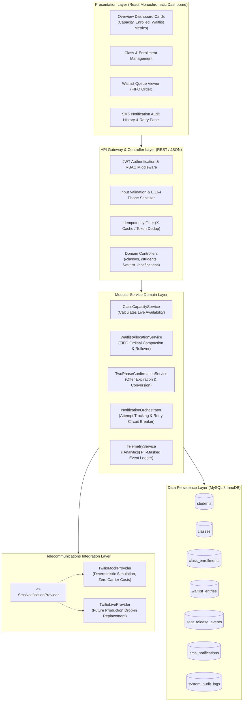
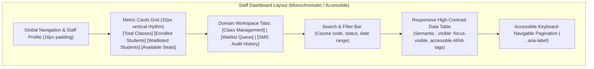

# System Architecture & Technical Design Specification
## Class Waitlist SMS Notification Job (Twilio Mock)
**Ticket ID:** ENG-135180  
**Epic:** Core Infrastructure Overhaul  
**Architecture Pattern:** Modular Service-Oriented Architecture (SOA) / Layered Enterprise Design  
**Database Engine:** MySQL 8.0+ (InnoDB Engine, ACID Transactional)  
**Status:** Approved Architecture Baseline (Capstone 1)  

---

## 1. System Architecture Overview

The system is architected as a modular, service-oriented backend supporting an accessible, monochromatic React web dashboard. The system decouples external telecommunications via a pluggable **Twilio Mock Provider** and guarantees ACID data consistency using MySQL 8 row-level locking.

### 1.1 High-Level Architecture Diagram



---

## 2. Layered Responsibilities & Component Architecture

### 2.1 API & Middleware Layer
1. **Input Validation Middleware:** Uses schema validators to enforce string lengths, non-whitespace rules, and E.164 phone regex (`^\+[1-9]\d{1,14}$`).
2. **Idempotency Interceptor:** Extracts `Idempotency-Key` headers on mutating requests (`POST /api/classes/{id}/seats/release`, `POST /api/waitlist/{id}/notifications`), querying `sms_notifications` for existing tokens.
3. **Role-Based Authorization (RBAC):** Authenticates JWT bearers, verifying whether the caller holds `Academic Staff` or `Operations Manager` permissions.

### 2.2 Modular Domain Services
1. **`ClassCapacityService`:** Computes real-time capacity and verifies invariants:
   $$\text{available\_seats} = \text{max\_capacity} - (\text{enrolled\_count} + \text{reserved\_count})$$
2. **`WaitlistAllocationService`:** Manages FIFO candidate selection, atomic positional shifts, and reservation offers under database row locks (`SELECT ... FOR UPDATE`).
3. **`TwoPhaseConfirmationService`:** Orchestrates the transition from `OFFERED` to `CONVERTED` upon student acceptance, or recycles seats when the 24-hour offer expires.
4. **`NotificationOrchestrator`:** Routes dispatch payloads to the active SMS provider, logs attempts in `sms_notifications`, manages retries, and enforces the 3-attempt circuit breaker.
5. **`TelemetryService`:** Dispatches structured analytics events:  
   `[Analytics] User interacted with Class Waitlist SMS Notification Job (Twilio Mock)`  
   scrubbing phone numbers, emails, and names from the log payloads.

---

## 3. Transaction Boundaries & Concurrency Strategies

### 3.1 Pessimistic Row-Level Locking Model
To eliminate double-allocation race conditions when multiple staff members release seats simultaneously:
```sql
START TRANSACTION;

-- Lock the class record
SELECT id, max_capacity FROM classes WHERE id = :classId FOR UPDATE;

-- Lock the next candidate at position 1
SELECT id, student_id, position 
FROM waitlist_entries 
WHERE class_id = :classId AND status = 'WAITING' AND position = 1 
FOR UPDATE;

-- Promote candidate to OFFERED and clear position
UPDATE waitlist_entries 
SET status = 'OFFERED', position = NULL, offer_expires_at = DATE_ADD(NOW(), INTERVAL 24 HOUR) 
WHERE id = :candidateWaitlistId;

-- Compact remaining queue positions
UPDATE waitlist_entries 
SET position = position - 1 
WHERE class_id = :classId AND status = 'WAITING' AND position > 1;

COMMIT;
```

### 3.2 Idempotency Token Enforcement
The system derives a deterministic idempotency key for every seat release notification:
$$\text{idempotency\_key} = \text{SHA-256}(\text{"OFFER-"} \parallel \text{waitlist\_id} \parallel \text{"-"} \parallel \text{release\_event\_id} \parallel \text{"-ATTEMPT-"} \parallel \text{attempt\_number})$$
The database constraint `UNIQUE KEY uq_idempotency_key (idempotency_key)` rejects duplicate insertions, preventing double notifications during client retries or network pauses.

---

## 4. UI/UX Dashboard Architecture (Future React Frontend)

The planned staff dashboard is structured around 5 responsive components adhering to the 16px/32px monochromatic design system:



---

## 5. Telemetry & Analytics Contract

### 5.1 Analytics Event Specification
- **Event Identifier:** `[Analytics] User interacted with Class Waitlist SMS Notification Job (Twilio Mock)`
- **Trigger Points:**
  1. Staff views waitlist queue.
  2. Staff adds student to waitlist.
  3. Staff triggers seat release.
  4. Notification is dispatched or retried via Twilio Mock.
  5. Student offer is confirmed or expires.
- **Privacy Enforcement:** Payloads strictly log entity IDs and operational action codes; personal contact details are completely omitted.

---
*End of Document. System Architecture & Technical Design Specification.*
