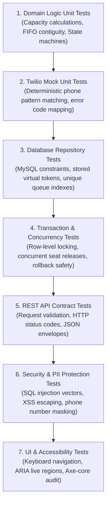

# Test-Driven Development (TDD) Plan & Test Specifications
## Class Waitlist SMS Notification Job (Twilio Mock)
**Ticket ID:** ENG-135180  
**Epic:** Core Infrastructure Overhaul  
**Status:** Approved Architecture Baseline (Capstone 1)  
**Document Artifact:** `docs/TEST_PLAN.md`  

---

## 1. Testing Strategy & Philosophy

In strict adherence to **Test-Driven Development (TDD)** and enterprise software engineering principles:
1. **Red $\rightarrow$ Green $\rightarrow$ Refactor:** All tests must be written, reviewed, and observed in a failing state against architectural contracts before any production feature code is authored.
2. **Deterministic & Isolated:** Tests must never depend on live external networks, actual SMS carrier gateways, or real API credentials.
3. **Pessimistic Concurrency Verification:** Concurrency tests must explicitly simulate race conditions (e.g. concurrent workers attempting to claim the same seat) to prove transaction isolation boundaries.
4. **Zero False Claims:** In accordance with the project guidelines, no test will be falsely claimed as passed during this architecture-only phase. Every scenario below represents a formal test specification for implementation in Capstone 2.

---

## 2. Recommended Test Frameworks & Tooling

Based on the greenfield workspace and Node.js v24.12 LTS runtime:

| Test Layer | Recommended Tool | Architectural Rationale |
| :--- | :--- | :--- |
| **Unit Testing** | `vitest` | Ultra-fast execution, native TypeScript/ESM support, Jest-compatible syntax, built-in mocking and code coverage. |
| **API Contract Testing** | `supertest` + `vitest` | Lightweight, expressive HTTP assertion library testing Express/Fastify REST routes against OpenAPI 3.0 contracts. |
| **Database Integration** | `testcontainers` (MySQL 8) | Spawns ephemeral, genuine MySQL 8 Docker containers to validate InnoDB row locking, generated stored columns, and CHECK constraints. |
| **Accessibility Testing** | `@axe-core/playwright` | Automated WCAG 2.1 AA audits, keyboard navigation simulation, and Lighthouse 100 validation. |

---

## 3. TDD Execution Sequence

To build the system safely from first principles, tests must be implemented and verified in the following sequential order:

---

## 4. Comprehensive Test Case Specifications

### 4.1 Unit Test Scenarios (Domain Logic)

| Test ID | Test Description | Preconditions | Input | Expected Result | Priority | Type |
| :--- | :--- | :--- | :--- | :--- | :--- | :--- |
| **UT-FIFO-01** | Initial waitlist position assignment | Class exists with `availableSeats = 0`; waitlist is empty. | Student ID 10 joins waitlist. | Entry assigned `position = 1`, `status = 'WAITING'`. | P1 - Blocker | Unit |
| **UT-FIFO-02** | Contiguous FIFO rank increment | Class has 2 students at positions 1 and 2. | Student ID 11 joins waitlist. | Entry assigned `position = 3`, `status = 'WAITING'`. | P1 - Blocker | Unit |
| **UT-FIFO-03** | Queue compaction upon candidate promotion | Class has 3 students at positions 1, 2, 3. | Position 1 promoted to `OFFERED`. | Promoted student position becomes `NULL`; former position 2 shifts to 1; position 3 shifts to 2. | P1 - Blocker | Unit |
| **UT-CAP-01** | Capacity calculation with active reservations | `maxCapacity = 30`, `enrolledCount = 28`, `reservedCount = 1`. | Capacity service calculates availability. | `availableSeats = 1` ($30 - (28 + 1)$). | P1 - Critical | Unit |
| **UT-CAP-02** | Prevent direct enrollment when class is full | `availableSeats = 0`. | Student requests direct enrollment. | Throws `ClassFullException` (`CLASS_FULL`). | P1 - Critical | Unit |
| **UT-CAP-03** | Prevent waitlist placement when seats are available | `availableSeats = 2`. | Student requests to join waitlist. | Throws `InvalidWaitlistOperationException` (`CLASS_HAS_AVAILABLE_SEATS`). | P1 - Critical | Unit |
| **UT-DEDUP-01**| Reject duplicate active student waitlist entry | Student ID 5 has active entry (`status = 'WAITING'`). | Student ID 5 attempts to join waitlist again. | Throws `DuplicateWaitlistException` (`STUDENT_ALREADY_WAITLISTED`). | P1 - Blocker | Unit |
| **UT-IDEMP-01**| Generate deterministic idempotency hash | Valid waitlist ID 12, event ID 4, attempt 1. | Idempotency generator called. | Returns matching SHA-256 string `SHA256("OFFER-12-4-ATTEMPT-1")`. | P1 - Critical | Unit |
| **UT-MOCK-01** | Mock phone routing: valid recipient | Twilio Mock service initialized. | Recipient: `+15005550006`, body: "Offer text". | Returns `status = 'SENT'`, `providerSid` starting with `SM`, `errorCode = null`. | P1 - Critical | Unit |
| **UT-MOCK-02** | Mock phone routing: invalid recipient | Twilio Mock service initialized. | Recipient: `+15005550001`. | Returns `status = 'FAILED'`, `errorCode = '21211'`, `errorMessage = "Invalid 'To' Phone Number"`. | P1 - Critical | Unit |
| **UT-MOCK-03** | Mock phone routing: simulated timeout | Twilio Mock service initialized. | Recipient: `+15005550003`. | Returns `status = 'FAILED'`, `errorCode = '54000'`, `errorMessage = "Gateway Timeout"`. | P1 - Critical | Unit |
| **UT-RETRY-01**| Retry counter increment and limit | Notification currently `FAILED` with `attempt_number = 1`. | Retry service invoked. | Dispatches message with `attempt_number = 2`. | P2 - High | Unit |
| **UT-RETRY-02**| Circuit breaker at maximum retry threshold | Notification currently `FAILED` with `attempt_number = 3`. | Retry service invoked. | Rejects with `MaxRetriesExceededException` (`MAX_RETRIES_EXCEEDED`). | P1 - Critical | Unit |

---

### 4.2 Integration Test Scenarios (Database & Service Layer)

| Test ID | Test Description | Preconditions | Input | Expected Result | Priority | Type |
| :--- | :--- | :--- | :--- | :--- | :--- | :--- |
| **IT-SEAT-01** | Atomic seat release and candidate promotion | Class at capacity with 3 waitlisted students. | `POST /api/classes/1/seats/release` (1 seat). | Seat release event created; position 1 updated to `OFFERED`; 24h expiration set; remaining entries shifted; SMS record inserted with `SENT`. | P1 - Blocker | Integration |
| **IT-ROLL-01** | Database transaction rollback on dispatch crash | Candidate selected for offer; database connection drops before SMS logging. | Seat release transaction crashes midway. | Entire transaction rolls back; candidate remains `WAITING` at position 1; no orphaned reservation or notification exists. | P1 - Blocker | Integration |
| **IT-CONF-01** | Two-phase offer conversion to enrollment | Waitlist entry in `OFFERED` status with valid timestamp. | Staff triggers `POST /api/waitlist/10/confirm`. | Waitlist entry transitions to `CONVERTED`; active enrollment created in `class_enrollments`; class `enrolledCount` increments. | P1 - Blocker | Integration |
| **IT-EXP-01**  | Offer expiration sweeper | Waitlist entry in `OFFERED` status with `offer_expires_at < NOW()`. | Expiration cron/worker runs. | Status transitions to `EXPIRED`; held seat released; next student at position 1 promoted to `OFFERED` and notified. | P1 - Critical | Integration |
| **IT-MOCK-04** | Persist failed SMS dispatch audit details | Recipient has test number `+15005550001`. | Seat release triggers notification. | Offer remains `OFFERED`; notification row stored with `status = 'FAILED'`, `error_code = '21211'`. | P1 - Critical | Integration |

---

### 4.3 API Contract & HTTP Validation Tests

| Test ID | Test Description | Preconditions | Input | Expected Result | Priority | Type |
| :--- | :--- | :--- | :--- | :--- | :--- | :--- |
| **API-CLS-01** | List classes with pagination | 25 classes seeded in database. | `GET /api/classes?page=1&limit=10` | `200 OK`, array of 10 classes, `pagination.totalRecords = 25`, `pagination.totalPages = 3`. | P1 - Critical | API |
| **API-CLS-02** | Create class with invalid dates | None. | `POST /api/classes` with `endDate` before `startDate`. | `400 Bad Request`, `VALIDATION_ERROR`, details highlighting date mismatch. | P2 - High | API |
| **API-STU-01** | Register student with valid E.164 phone | None. | `POST /api/students` with phone `+15005550006`. | `201 Created`, returns student JSON with UUID. | P1 - Critical | API |
| **API-STU-02** | Register student with invalid phone format | None. | `POST /api/students` with phone `555-0199`. | `400 Bad Request`, `INVALID_PHONE_FORMAT`. | P1 - Critical | API |
| **API-WL-01**  | Withdraw from waitlist | Student at position 2 in waitlist. | `DELETE /api/waitlist/15` | `200 OK`, `status = 'WITHDRAWN'`, subsequent entries shifted. | P1 - Critical | API |
| **API-WL-02**  | Non-existent waitlist ID lookup | Waitlist ID 999999 does not exist. | `GET /api/waitlist/999999` | `404 Not Found`, `RESOURCE_NOT_FOUND`. | P2 - High | API |
| **API-IDEMP-01**| Duplicate notification dispatch request | Notification already dispatched with key `IDEMP-001`. | Repeat `POST` with identical `Idempotency-Key: IDEMP-001`. | `200 OK`, returns original cached record, header `X-Cache-Lookup: HIT-IDEMPOTENT`. | P1 - Blocker | API |
| **API-AUTH-01**| Reject unauthenticated request | None. | `POST /api/classes` without `Authorization` header. | `401 Unauthorized`. | P1 - Critical | API |

---

### 4.4 Concurrency, Edge Case & Stress Tests

| Test ID | Test Description | Preconditions | Input | Expected Result | Priority | Type |
| :--- | :--- | :--- | :--- | :--- | :--- | :--- |
| **EC-RACE-01** | Concurrent seat releases (Two staff members) | Class has exactly 1 available seat and 5 waitlisted students. | Worker A and Worker B simultaneously invoke `POST /api/classes/1/seats/release`. | Pessimistic locking serializes execution: Worker A releases seat and promotes Candidate 1; Worker B detects 0 available seats and returns `409 Conflict` or graceful 0-allocation. Zero double bookings. | P1 - Blocker | Concurrency |
| **EC-MULTI-01**| Multi-seat release batch | Class has 3 seats opened; 5 waitlisted students. | `POST /api/classes/1/seats/release` with `seatsToRelease = 3`. | Top 3 candidates (`positions 1, 2, 3`) transitioned to `OFFERED`; 3 distinct notifications dispatched; former position 4 becomes 1. | P1 - Critical | Concurrency |
| **EC-EMPTY-01**| Seat release with empty waitlist | Class has 0 waitlisted students; 1 seat opens. | `POST /api/classes/1/seats/release`. | `200 OK`, `seatsReleased = 1`, `candidatePromoted = null`, `availableSeats` increments by 1. Zero notifications generated. | P2 - High | Edge Case |
| **EC-DISC-01** | Client disconnection during dispatch | Client submits seat release request and terminates connection immediately. | Server receives request with `Idempotency-Key: K1`. | Server completes transaction; on client reconnect and retry with `K1`, returns committed result without duplicate processing. | P1 - Critical | Edge Case |

---

### 4.5 Security & Data Privacy Tests

| Test ID | Test Description | Preconditions | Input | Expected Result | Priority | Type |
| :--- | :--- | :--- | :--- | :--- | :--- | :--- |
| **SEC-SQL-01** | SQL Injection via course search parameter | Classes seeded in database. | `GET /api/classes?search=' OR '1'='1` | Parameterized query treats input as literal string; does not dump unauthorized records. | P1 - Blocker | Security |
| **SEC-XSS-01** | Stored XSS payload in student name | None. | `POST /api/students` with `firstName = ""`. | Input stored authentically; API returns JSON without executing; UI test verifies React JSX escapes string safely. | P1 - Blocker | Security |
| **SEC-PII-01** | Phone number masking in public queue views | Waitlist seeded with student phones. | `GET /api/classes/1/waitlist` | Response payload masks phone as `+1500555***6`; raw phone is not exposed in list API. | P1 - Critical | Security |
| **SEC-AUTH-01**| RBAC role violation: Staff altering capacity | User authenticated as Academic Staff. | `PUT /api/classes/1` with new `maxCapacity`. | `403 Forbidden` (`INSUFFICIENT_PERMISSIONS`). Only Operations Managers may alter capacity. | P1 - Critical | Security |

---

### 4.6 Accessibility & Inclusive UI Tests

| Test ID | Test Description | Preconditions | Input | Expected Result | Priority | Type |
| :--- | :--- | :--- | :--- | :--- | :--- | :--- |
| **A11Y-AXE-01**| Automated Axe-core WCAG 2.1 AA audit | Dashboard rendered with waitlist table. | Run `@axe-core/playwright` audit. | Zero violations detected (Color contrast $\ge 4.5:1$, form labels present, table headers structured). | P1 - Critical | Accessibility |
| **A11Y-KEY-01**| Keyboard navigation & focus sequence | Dashboard loaded. | User presses `Tab` through navigation, search, and table actions. | Logical tab order; every active element displays a high-contrast `:focus-visible` ring; no keyboard traps. | P1 - Critical | Accessibility |
| **A11Y-LIVE-01**| Screen reader dynamic notification announcement | Staff triggers seat release. | Mock notification completes. | Status message injected into `
` and announced to screen reader. | P2 - High | Accessibility |
| **A11Y-MOD-01**| Modal dialog focus trapping | "Release Seat" modal open. | User presses `Tab` repeatedly. | Focus cycles exclusively within modal buttons; pressing `Escape` closes modal and restores focus to trigger. | P2 - High | Accessibility |

---

## 5. Items Currently Untestable (Architecture Phase Boundary)

In strict adherence to the **do not pretend tests have passed** directive, the following items cannot be executed in this turn:
1. **Live Containerized MySQL 8 Execution:** Requires starting a local Docker container or active MySQL daemon (to be executed during Capstone 2 implementation).
2. **End-to-End Browser UI Rendering:** Requires authored React components (to be executed during frontend development phase).
3. **Real Lighthouse Performance Measurement:** Requires a running HTTP server with rendered DOM to compute actual lab scores.

---
*End of Document. TDD Test Plan & Test Specifications.*
