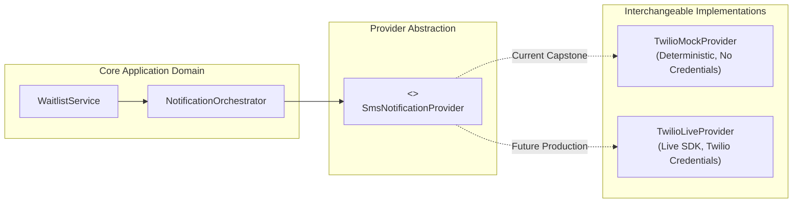

# Twilio Mock Architecture & SMS Simulation Specification
## Class Waitlist SMS Notification Job (Twilio Mock)
**Ticket ID:** ENG-135180  
**Epic:** Core Infrastructure Overhaul  
**Status:** Approved Architecture Baseline (Capstone 1)  

---

## 1. Architectural Philosophy & Zero-Cost Simulation

In enterprise application development, integrating directly with production telecommunication gateways (such as Twilio, AWS SNS, or Vonage) during testing and early phases introduces:
- Ongoing carrier transaction costs.
- Risk of spamming real student mobile numbers with test data.
- Dependence on live external internet connectivity and API keys.
- Inability to deterministically trigger edge-case carrier failures (e.g. invalid handset, rate limiting, network timeouts).

The **Twilio Mock Architecture** provides an isolated, deterministic simulation layer that faithfully reproduces the behaviors, data models, error codes, and latency profiles of the Twilio REST API without initiating any real telecommunication calls.

---

## 2. Mock Service Interface Contract & Decoupling

The backend interacts strictly with an abstract `SmsNotificationProvider` interface via Dependency Injection (DI):

```typescript
// Core abstraction interface
export interface SmsNotificationPayload {
  to: string;             // Recipient phone in E.164 format
  from: string;           // Sender alphanumeric ID or phone
  body: string;           // Formatted SMS message body
  idempotencyKey: string; // Unique deduplication token
}

export interface SmsNotificationResult {
  providerSid: string;    // Twilio SID: "SM" + 32 hex characters
  status: 'SENT' | 'FAILED';
  attemptNumber: number;
  errorCode?: string;     // Twilio-compatible error code (e.g. "21211")
  errorMessage?: string;  // Detailed explanation of failure
  sentAt?: Date;
  mockLatencyMs: number;
}

export interface SmsNotificationProvider {
  dispatchMessage(payload: SmsNotificationPayload): Promise<SmsNotificationResult>;
}
```

---

## 3. Deterministic Simulation Rules & Phone Pattern Routing

To enable comprehensive test coverage without mocking frameworks at runtime, the Twilio Mock Provider evaluates recipient phone numbers against reserved test patterns:

| Recipient Number | Simulation Target | Simulated Outcome | Twilio Error Code | Error Message |
| :--- | :--- | :--- | :--- | :--- |
| `+15005550006` | Standard Valid Recipient | **SENT** | `None` | Delivered to simulated handset |
| `+15005550001` | Invalid Phone Number | **FAILED** | `21211` | Invalid 'To' Phone Number |
| `+15005550002` | Destination Handset Unreachable | **FAILED** | `30003` | Destination handset unreachable |
| `+15005550003` | Gateway Timeout (Simulated 504) | **FAILED** | `54000` | Carrier connection timed out |
| `+15005550004` | Recipient Blacklisted / Unsubscribed | **FAILED** | `21610` | Message cannot be sent; recipient unsubscribed |
| `+15005550008` | Carrier Rate Limit / Throttling | **FAILED** | `20429` | Too Many Requests (Rate limit exceeded) |
| Standard E.164 | General Testing | **SENT** | `None` | Delivered to simulated handset |

### 3.1 Controlled Latency Simulation
Real carrier calls introduce latency. The mock service injects configurable artificial delays (default: 50ms – 100ms) to ensure asynchronous race condition detection and promise handling in the application layer are verified accurately during development.

---

## 4. Audit Trail & Database Persistence

Every mock execution produces an immutable record in `sms_notifications`:

```sql
INSERT INTO sms_notifications (
    notification_uuid,
    waitlist_entry_id,
    seat_release_event_id,
    recipient_phone,
    message_body,
    idempotency_key,
    status,
    attempt_number,
    mock_message_sid,
    error_code,
    error_message,
    sent_at
) VALUES (
    :uuid,
    :waitlistEntryId,
    :releaseEventId,
    :recipientPhone,
    :messageBody,
    :idempotencyKey,
    :status,           -- 'SENT' or 'FAILED'
    :attemptNumber,    -- 1, 2, or 3
    :mockMessageSid,   -- e.g. 'SM7a8b9c0d1e2f3a4b5c6d7e8f9a0b1c2d'
    :errorCode,        -- e.g. '21211' or NULL
    :errorMessage,     -- e.g. 'Invalid To Phone Number' or NULL
    :sentAt            -- Timestamp if SENT, NULL if FAILED
);
```

---

## 5. Safe Retry Engine & Circuit Breaker

### 5.1 Retry Lifecycle
1. Staff or background worker queries failed notifications:  
   `SELECT * FROM sms_notifications WHERE status = 'FAILED' AND attempt_number < 3;`
2. Staff clicks "Retry Notification" (`POST /api/notifications/{id}/retry`).
3. System verifies `attempt_number < 3`. If `attempt_number >= 3`, rejects with `422 Unprocessable Entity` (`MAX_RETRIES_EXCEEDED`).
4. System invokes `SmsNotificationProvider.dispatchMessage` with an incremented `attempt_number` and a newly derived `idempotencyKey`:
   $$\text{idempotencyKey} = \text{SHA-256}(\text{"RETRY-"} \parallel \text{waitlist\_id} \parallel \text{"-ATTEMPT-"} \parallel \text{attempt\_number})$$
5. The result is appended to the audit history.

---

## 6. Migration Blueprint: Transitioning to Real Twilio

When transitioning from the mock service to live Twilio in future phases, **zero business logic, waitlist algorithms, or database schemas will require changes**.



### 6.1 Steps for Future Production Enablement:
1. Create `TwilioLiveProvider` implementing `SmsNotificationProvider` using official `twilio-node` SDK.
2. Inject `TWILIO_ACCOUNT_SID`, `TWILIO_AUTH_TOKEN`, and `TWILIO_PHONE_NUMBER` via secure environment variables.
3. Update Dependency Injection container binding from `TwilioMockProvider` to `TwilioLiveProvider`.
4. Run integration test suite using live test credentials.

---
*End of Document. Twilio Mock Architecture Specification.*
